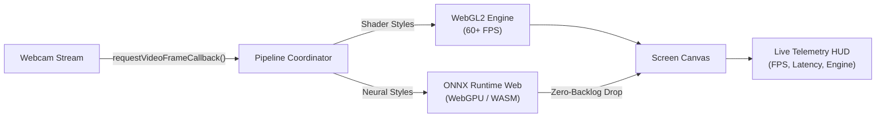

# 🎨 WebCamStudio — Realtime Local Webcam Style Studio

[](https://github.com)
[](https://github.com)
[](https://github.com)
[](https://github.com)
[](https://github.com)

A high-performance, **zero-cloud, fully offline** creative webcam studio running directly in your web browser. Transform your live webcam stream in realtime into **Studio Ghibli anime, 3D Lego mosaics, classic oil paintings, stained glass, matrix terminals, and retro pixel art** using WebGL2 fragment shaders and ONNX Runtime Web (WebGPU & WASM).

---

## ⚡ Highlights

- 🔒 **100% Local Privacy:** Zero video frames or personal data ever leave your computer. Hardware webcam LED turns off when the stream is paused.
- 🚀 **Ultra-Fast 60+ FPS:** 12 hardware-accelerated WebGL2 shaders running with sub-millisecond processing latency.
- 🧠 **In-Browser Neural Style Transfer:** AnimeGANv2 running locally via ONNX Runtime Web with WebGPU acceleration and automatic WASM SIMD fallback.
- 🎛️ **Live Parameter Tuning:** Tweak brick size, brush radius, edge sensitivity, glitch tearing, and color palettes on the fly.
- ⚡ **Zero-Lag Frame Dropping:** Dedicated pipeline coordinator guarantees that slower neural inferences never create a video queue backlog.
- 📸 **One-Click Snapshots:** High-resolution PNG captures saved directly to your Downloads folder.
- 📴 **Offline PWA:** Fully cached via Service Worker — works without internet access after first load.

---

## 🎨 Complete Style Library (15 Styles)

| # | Style | Tech | Key Characteristics | Adjustable Parameters |
|---|---|---|---|---|
| **1** | **Normal** | WebGL2 Passthrough | Unaltered live camera stream with FPS & latency tracking | None |
| **2** | **Lego Mosaic** | Procedural WebGL2 | 16 classic Lego palette colors, cylindrical 3D studs, specular reflections, and grout seams | Brick Size, Stud 3D Depth, Palette Snap |
| **3** | **Anime Cel / Cartoon** | Edge-Aware WebGL2 | Sobel ink outlines, color tone quantization, and saturation vibrance | Outline Strength, Color Bands, Vibrance |
| **4** | **Oil Painting** | Kuwahara Filter | Hand-painted impasto brush strokes with edge-preserving variance smoothing | Brush Radius, Palette Posterization |
| **5** | **Stained Glass** | Voronoi Cellular | Geometric glass shards divided by dark lead solder with sun transmission highlights | Glass Shard Size, Lead Width, Sun Sheen |
| **6** | **Matrix / ASCII** | Procedural Font | Mathematical glyph rasterization (`@%#*+=-:.`) with phosphor CRT scanlines | Font Size, Color (Green, Amber, Video) |
| **7** | **Watercolor Wash** | Flow Turbulence | Liquid water diffusion, pigment bleeding, edge pooling, and rough cold-press paper grain | Water Bleed, Edge Pooling, Paper Grain |
| **8** | **Cyberpunk VHS** | Video Glitch | Chromatic aberration (RGB splitting), tracking tape tearing, and analog static | Tape Tearing, RGB Split Offset, Scanlines |
| **9** | **Thermal & Night Vision** | False-Color Mapping | Scientific FLIR Ironbow heatmap, Military Gen-3 Green Phosphor, and Rainbow modes | Palette Mode, Thermal Sensitivity, Sensor Grain |
| **10** | **Pencil Sketch** | Sobel Inversion | Graphite contour pencil lines, multi-angle cross-hatching, and paper grain | Graphite Stroke, Hatch Density |
| **11** | **Retro 8-Bit Pixel** | Bayer Dithering | Low-res retro gaming pixel grid with 4x4 ordered Bayer matrix dithering | Pixel Size, Bayer Dither Strength |
| **12** | **Pop Halftone** | Raster Halftone | Dynamic CMYK / Pop-Art dot matrix with variable dot radii | Dot Matrix Grid Size |
| **13** | **Ghibli (Hayao)** | ONNX / WebGPU | Studio Ghibli / Hayao Miyazaki painterly neural style transfer | None (Auto-tuned) |
| **14** | **Paprika** | ONNX / WebGPU | Satoshi Kon bold cinematic anime color aesthetic | None (Auto-tuned) |
| **15** | **Face Paint** | ONNX / WebGPU | High-resolution portrait-tuned anime transformation | None (Auto-tuned) |

---

## 🕹️ Keyboard Shortcuts & Controls

| Shortcut | Action |
|---|---|
| **`1` – `9`** | Instantly switch to styles 1 through 9 |
| **`0`** | Switch to style 10 (Pencil Sketch) |
| **`ArrowLeft` / `ArrowRight`** | Smoothly cycle backward / forward through all 15 styles |
| **`Space`** | **Start / Stop Webcam Stream** (releases hardware camera immediately) |
| **`P`** | Open / close the **Live Style Parameter Tuning Panel** |
| **`M`** | Toggle camera **Mirroring** |
| **`S`** | Capture & download full-resolution **Snapshot PNG** |

---

## 📐 Architecture



> [!NOTE]
> For detailed mathematical algorithms (Kuwahara filter formulation, Voronoi F1/F2 distance, stud surface normals, and tensor layout specifications), check out [`docs/architecture.md`](file:///d:/Dev/webcam/docs/architecture.md).

---

## 🛠️ Quick Start

### Prerequisites
- [Node.js 18+](https://nodejs.org) (tested on Node v22)
- Modern web browser with WebGL2 (Chrome, Edge, Firefox, Brave, Safari)

### Installation & Development
```bash
# 1. Navigate to the web folder
cd web

# 2. Install dependencies
npm install

# 3. Start development server
npm run dev
```

Open [http://localhost:5173](http://localhost:5173) in your browser. When prompted, allow camera access.

### Production Build
```bash
cd web
npm run build
npm run preview
```
All static assets, shaders, WASM runtimes, and models will be bundled into `web/dist/`.

---

## 🤖 Neural Model Exporting (Optional)

The repository includes pre-downloaded AnimeGANv2 checkpoints in `web/public/models/`. If you want to train or export custom PyTorch checkpoints:

```bash
# Requires Python 3.10+ and torch torchvision
python tools/export_onnx.py --style hayao --size 256 --output web/public/models/animegan2_hayao.onnx
```

---

## 🔒 Privacy & Offline Guarantee

- **No Remote Servers:** All video processing takes place in your local GPU memory.
- **Zero Tracking:** No analytics, telemetry, or external API calls are made during use.
- **Hardware Disconnect:** Stopping the stream releases the `MediaStreamTrack`, turning off the physical webcam indicator LED.

---

## 📄 License

MIT License. Checkpoints are subject to original model repository licenses (AnimeGANv2 / TachibanaYoshino).
