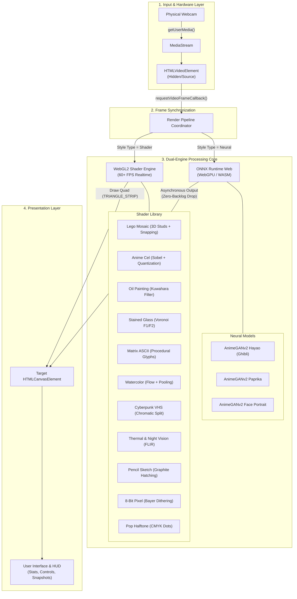
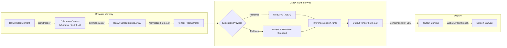

# Architecture & Technical Deep Dive: Realtime Local Webcam Style Transfer

This document explains the end-to-end architecture, rendering pipelines, mathematical algorithms, and performance optimizations powering the application.

---

## 1. System Architecture Overview

The system runs **100% on-device** inside modern web browsers with zero backend or cloud network requests.



---

## 2. Stream Synchronization & Render Loop

A critical design challenge in realtime webcam apps is avoiding frame queue backlogs. If processing takes longer than the camera's shutter interval, queuing frames introduces compounding latency (lag).

```mermaid
sequenceDiagram
    autonumber
    participant Camera as Webcam Hardware
    participant Video as HTMLVideoElement
    participant Loop as Render Pipeline
    participant GL as WebGL2 Engine
    participant NN as ONNX Neural Engine
    participant Canvas as Screen Canvas

    Camera->>Video: Deliver hardware frame (30/60 fps)
    Video->>Loop: requestVideoFrameCallback() trigger
    
    alt Active Style is Shader (e.g. Lego, Oil, Glitch)
        Loop->>GL: Upload frame to 2D Texture (texImage2D)
        Loop->>GL: Execute fragment shader program with uniforms
        GL->>Canvas: Draw full-screen quad (Instant ~0.5ms - 2ms)
    else Active Style is Neural (e.g. Hayao Ghibli)
        GL->>Canvas: Render latest processed frame (Flicker-free)
        alt Neural Engine is Idle (canProcess = true)
            Loop->>NN: Scale & format input tensor (Float32Array)
            NN->>NN: WebGPU / WASM execution
            NN->>GL: Write inference result to output buffer
        else Neural Engine is Busy
            Loop->>Loop: Drop frame immediately (No backlog!)
        end
    end
```

### Frame-Dropping Architecture
When running neural models (which may take 25–60ms depending on GPU power):
1. The display loop continues rendering at the screen's refresh rate.
2. If `neural.canProcess()` is `false`, the incoming camera frame is **dropped immediately**.
3. The display continues rendering the last completed neural frame via WebGL passthrough.
4. Result: **Zero latency buildup**, zero UI freezing, and maximum possible inference throughput.

---

## 3. Shader Engine: Mathematical Algorithms

The WebGL2 engine executes single-pass fragment shaders on a full-screen quad (2 triangles, 4 vertices). Every pixel is calculated in parallel on the GPU.

### A. Lego Mosaic (`lego.frag`)
1. **Grid Quantization:** Frag coordinates are divided by brick size:
   $$\text{cell} = \lfloor \frac{\mathbf{p}}{\text{brickSize}} \rfloor$$
2. **Palette Snapping:** The center color of the cell is snapped to one of 16 standardized classic Lego colors using perceptual color weights (human eye sensitivity: 0.299 R, 0.587 G, 0.114 B):
   $$\Delta E = 0.299(R_1 - R_2)^2 + 0.587(G_1 - G_2)^2 + 0.114(B_1 - B_2)^2$$
3. **3D Stud Surface Normals:** Coordinates inside the cell are normalized to $[-1, 1]$. For radius $r = \|\mathbf{p}_{\text{local}}\|$:
   - For $r \in [r_{\text{inner}}, r_{\text{outer}}]$, outward radial normals simulate cylindrical side bevels:
     $$\mathbf{N} = \text{normalize}\left(\frac{\mathbf{p}_{\text{local}}}{r} \sin(\theta), \cos(\theta)\right)$$
   - A directional light source $\mathbf{L} = (-0.6, 0.7, 0.5)$ casts Blinn-Phong specular reflections and a soft drop shadow on the bottom-right of the stud plate.
4. **Tile Grout / Edge Bevel:** Cell boundaries $(\|\mathbf{p}\| > 0.88)$ receive highlight on top-left and shadow on bottom-right to create physical depth between bricks.

### B. Oil Painting (`oil.frag` — Kuwahara Filter)
The Kuwahara filter provides edge-preserving smoothing that emulates oil paint brush strokes:
1. A window of radius $R$ around pixel $(x, y)$ is partitioned into 4 overlapping quadrants ($Q_0, Q_1, Q_2, Q_3$).
2. For each quadrant $k \in \{0, 1, 2, 3\}$, the shader computes:
   - Mean color vector: $\mathbf{m}_k = \frac{1}{N} \sum_{p \in Q_k} C(p)$
   - Variance (dispersion): $\sigma_k^2 = \frac{1}{N} \sum_{p \in Q_k} (C(p) - \mathbf{m}_k)^2$
3. The output pixel is assigned the mean $\mathbf{m}_k$ of the quadrant with the **lowest variance**:
   $$C_{\text{out}} = \mathbf{m}_{\arg\min_k(\sigma_k^2)}$$
4. Result: Uniform regions are smoothed into flat paint strokes, while high-contrast edges are strictly preserved.

### C. Stained Glass (`stained_glass.frag` — Voronoi Facets)
1. **Cellular Noise:** The 2D plane is divided into a grid. Each cell contains a pseudo-random jittered seed point.
2. **F1 and F2 Distances:** For each pixel, the Euclidean distance to the closest seed ($F_1$) and second-closest seed ($F_2$) is calculated.
3. **Lead Solder Border:** The border between adjacent glass shards occurs where the difference between distances approaches zero:
   $$\text{border} = \text{smoothstep}(0.0, w_{\text{lead}}, F_2 - F_1)$$
4. **Glass Refraction & Sheen:** Shard colors are sampled from the seed origin, with saturation boosted by 1.4x and normals tilted toward the seed center to simulate convex glass panes reflecting sunlight.

### D. True ASCII / Matrix Terminal (`ascii.frag`)
1. Frag coordinates are partitioned into character cells of aspect ratio $1 : 1.4$.
2. The luminance of the center pixel is computed:
   $$L = 0.299R + 0.587G + 0.114B$$
3. $L$ maps to one of 9 discrete procedural glyphs (` `, `.`, `:`, `-`, `+`, `*`, `#`, `%`, `@`).
4. Mathematical geometric rasterization calculates pixel coverage inside the character cell without needing an external font texture.
5. Phosphor scanline modulation and CRT color grading (Matrix Green, Amber CRT, or Full-Color Video) are applied.

### E. Watercolor Wash (`watercolor.frag`)
1. **Turbulent Flow:** Low-frequency smooth noise perturbs the UV coordinates before sampling, simulating liquid water diffusion on paper.
2. **Pigment Bleed:** Multi-sample weighted kernel averages neighboring color values.
3. **Edge Granulation:** Sobel gradient magnitude identifies stroke borders where drying water causes pigment pooling.
4. **Paper Tooth:** High-frequency grain simulates the tooth of cold-press rough watercolor paper.

### F. Cyberpunk VHS Glitch (`glitch.frag`)
1. **Tape Tearing:** Horizontal scanline bands are randomly displaced using a time-seeded hash.
2. **Chromatic Aberration:** Separate red, green, and blue texture lookups with horizontal pixel offsets:
   $$R = T(\text{uv} + \Delta x), \quad G = T(\text{uv}), \quad B = T(\text{uv} - \Delta x)$$
3. **Analog CRT Lines:** Sinusoidal scanline modulation with high-ISO tape static noise.

### G. Thermal & Night Vision (`thermal.frag`)
1. Input luminance represents temperature $T = L^{\gamma}$.
2. Mapped through a multi-stage scientific **FLIR Ironbow** color ramp:
   - Deep Navy Purple $\rightarrow$ Violet $\rightarrow$ Flame Red $\rightarrow$ Amber Yellow $\rightarrow$ Searing White Hot.
3. Or military **Gen-3 Green Phosphor** with optical lens vignetting.

---

## 4. Neural Engine: ONNX Runtime Web



### Tensor Formatting & Layouts
Different neural architectures expect different memory layouts:
- **AnimeGANv2 (Hayao & Paprika):** Tensor shape `[1, 256, 256, 3]` in **NHWC** (interleaved RGB) layout normalized to $[-1.0, 1.0]$.
- **AnimeGANv2 (FacePaint):** Tensor shape `[1, 3, 512, 512]` in **NCHW** (planar RGB) layout normalized to $[-1.0, 1.0]$.

The engine auto-detects the layout from the model specification and formats the `Float32Array` buffer accordingly.

---

## 5. Security, Isolation & Offline Architecture

Modern browser capabilities like WebAssembly multithreading and high-precision timers (`performance.now()`) require **Cross-Origin Isolation**:

- **COOP Header:** `Cross-Origin-Opener-Policy: same-origin`
- **COEP Header:** `Cross-Origin-Embedder-Policy: credentialless`
- **CORP Header:** `Cross-Origin-Resource-Policy: cross-origin`

### Privacy & Offline Guarantees
- **No telemetry, analytics, or cloud APIs:** All compute takes place on the client's GPU.
- **Service Worker (`sw.js`):** Intercepts requests and caches all application code, WASM binaries, and ONNX models for full offline functionality.
- **Hardware Release:** When the user clicks **Stop Stream**, all `MediaStreamTrack` instances are stopped, immediately turning off the physical camera light.
